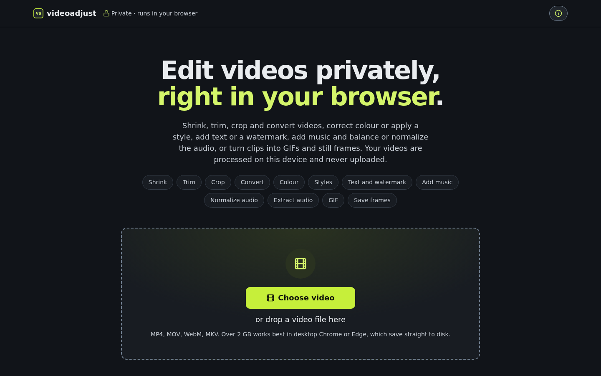

# videoadjust

[](https://github.com/bradsec/videoadjust/actions/workflows/tests.yml)
[](package.json)
[](LICENSE)
[](https://videoadjust.com/)

A private video editor that runs in your browser. Trim, crop, resize and rotate, correct colour, apply styles and overlays, add music and adjust or extract audio, make GIFs and save frames. [Mediabunny](https://mediabunny.dev/) runs conversion locally through WebCodecs, so your videos are processed on your device and never uploaded.

**Live app: https://videoadjust.com/**



## Features

- Pick a video, trim it, choose a tool and its settings, then export. Video output defaults to MP4 with H.264 video and AAC audio; WebM (VP9, AV1, Opus) is also available. Frames are never upscaled and the frame rate is never raised. No ffmpeg.wasm.
- On the prepare screen, choose Shrink video, Extract audio or GIF from the workspace tabs. The file name and details come first, then the preview, an Edit section (Crop and rotate, and Position overlay once an overlay is set) and Trim. The video and trim controls form the canvas; the summary, action, Reset all and the settings sections form the inspector. Settings sit in collapsible sections (Output, Audio, Colour correction, Style, Overlay) that open one at a time, each header showing its change count. The preview reflects the output resolution and frame rate, so a lower resolution looks softer and a lower frame rate steps. GIF preview also shows the selected colour limit. Short confirmations, such as a saved frame or a reset, appear as toast notifications that float over the page without moving it; errors stay until dismissed. On desktop they sit side by side, with a sticky inspector that scrolls long settings independently. Theater mode widens the canvas across the window while keeping the inspector at a fixed width, on Prepare and on the result comparison; the setting is saved in this browser. Scroll back up within the inspector to reach Export. On narrower screens they stack, with the summary and action fixed at the bottom on phones and sticky within the inspector on tablets.
- Extract audio is unavailable until the source or an added file has usable audio. GIF is unavailable when the source has no decodable video.
- Hover a setting or edit control for a short explanation of what it does.
- All three tools use the same trim. The timeline ruler marks time above the filmstrip. The filmstrip adds thumbnails as it widens, up to 40, and limits them on short clips. Drag the trim handles or use arrow keys to adjust by 0.1 seconds. Hold Shift with an arrow key for 1-second steps. Edit the Start or End time using seconds, m:ss, or h:mm:ss, with optional tenths. Use the adjacent Set button to place that boundary at the preview playhead. The kept duration and summary update as you trim. Reset trim appears when a boundary changes and restores the full source duration in all three tools.
- Drag the white playhead or click the ruler or filmstrip to seek. With the playhead focused, Left and Right move 1 second, Shift with Left or Right moves 5 seconds, Page Up and Page Down move 10 seconds, and Home and End jump to the trim boundaries.
- Press Space to play or pause the preview when focus is outside a control or editor.
- The source summary shows whether sampled frames have a variable frame rate and whether the video is HDR, when Mediabunny can determine those properties.
- If the browser cannot play the preview, the handles and thumbnails still work. The trim Set buttons are disabled because they need a playhead.
- Reset all in any tool's summary resets every tool for the loaded file. Click Reset all, then Confirm reset; Cancel or Escape keeps the settings. It restores load-time automatic export settings, full trim, Fast trim precision, no crop/rotation/mirror, Style None with neutral colour correction, overlays off, neutral Master processing, and original audio included at 0 dB. It removes the added audio track and uploaded watermark image. The source file, selected tool tab, theater mode, browser preferences and uploaded custom fonts stay. Reset is disabled when all settings are automatic or an export is starting.
- Shrink's summary card shows the estimated output range against the original size. Open Adjust to change format, codec, resolution, frame rate, quality, or audio. Each setting has a reset button.
- Shrink’s Target size offers Off, 8, 10, 16, 25, 50, or 100 MB, plus Custom (0.05–4096 MB). MB means 1,000,000 bytes. The budget follows the kept duration, reserves container overhead and 8% headroom, and replaces the Quality slider. Tight targets lower audio to 96 or 64 kbps and step down resolution; a warning suggests a shorter trim when the smallest size is still tight. Compatible trimmed copies already under the target keep the copy path. Encoders can overshoot; the result shows actual versus target and offers Try again smaller with a reduced bitrate for another export.
- Choose Crop and rotate in the Edit section under the preview to edit the current frame. The canvas editor shows rotation and mirroring on a still frame; Done returns to live playback with your edits. Shrink and GIF preview rotation, mirroring, crop and overlays while playing or scrubbing, without encoding. Show original temporarily hides those edits and appears only when edits exist. Choose Free, Original, 1:1, 4:5, 9:16, or 16:9. Original locks to the rotated frame's ratio; its full-frame guide leaves the video uncropped. Each locked ratio starts with the largest centred crop and stays locked while you resize it. Drag inside the guide to move it, or drag an edge or corner to resize. The move and size buttons offer a click alternative. Focus the guide and use arrow keys to move, Shift with arrows for larger steps, or Alt with arrows to resize. Rotation, mirroring and crop are set only in this editor; Adjust has no separate controls for them. Rotation and mirroring happen before cropping and resizing. A smaller crop, rotation, or mirroring re-encodes the video and keeps audio copy when available.
- Set an optional output title under Metadata. Strip source metadata is on by default and removes source descriptive tags (such as location, device and dates), while retaining any title you entered; turn it off to keep them. Extract audio always strips source tags. Metadata changes can be applied to a trimmed copy without re-encoding the video.
- Seekability offers the default keyframe interval or 1-second and 2-second intervals. Shorter intervals improve seeking but increase file size. Choosing either interval re-encodes the video; the size estimate does not account for extra keyframes.
- Shrink's Trim precision defaults to Fast (keyframe), which copies compatible video. A copied MP4 can retain encoded footage before the chosen start, hidden during normal playback by its edit list. Choose Exact (re-encode) to remove that footage: it re-encodes video at frame boundaries, takes longer and can change quality or size. Audio copy remains available. GIF always renders the selected frames.
- Unavailable codecs show why they cannot be selected. WebM uses Opus audio. The quality control and audio bitrates stay within the source limits. Quality keeps the same percentage when you change codec, resolution, or frame rate. Reset Quality returns to 100% for the current video settings.
- If the source is already small, Export makes a trimmed copy that keeps the source video and audio tracks. Select Re-encode anyway to use the adjustment controls.
- Extract audio defaults to MP3. Open Adjust to choose MP3, M4A (AAC), or WAV, plus bitrate and mono or stereo where available. M4A copies the source audio without re-encoding when the source is AAC at or below the target bitrate; otherwise it encodes AAC at the target. MP3 and WAV are always encoded. WAV is 16-bit PCM with no bitrate control, so files are large. The audio summary shows the estimated size and kept duration.
- Shrink and Extract audio share one Audio tracks section above the tool settings. Original audio has an include switch and a volume slider (-20 to +20 dB, in 0.5 dB steps, matching Master gain so 0 dB sits in the middle). Turn it off to remove the source audio. Reset original audio appears when inclusion or volume changes and restores inclusion at 0 dB, leaving the added track unchanged. This replaces the old Remove audio codec option. Add music or audio picks one local audio or video file with a decodable primary audio track; its name and duration appear beside volume, start offset, Loop, and Remove controls. Offset starts on the output timeline: a positive offset starts the added audio after the trim start, and a negative offset starts it partway into the file, so a track longer than the clip can play from any point. Loop repeats shorter audio; added audio always ends at the kept range end. Silent videos can gain audio, and disabling Original audio keeps only the added track. Both export tools use the same tracks and Master settings. GIF has no audio.
- Under Trim, Original and Added waveform lanes follow the same full-source timeline and playhead. Added audio appears at its offset and repeats when Loop is on. Drag the Added lane left or right, or focus it and use the arrow keys (Shift for 1-second steps, Home and End for the limits), to slide the track and choose which part plays. Removed audio is dimmed. Track volumes, Master gain, fades and measured normalization update the lanes immediately, without decoding peaks again. Orange marks possible peaks above -1 dBFS: cached peak bins cannot preserve phase, so warnings are conservative estimates rather than an exact mixed waveform.
- Master controls apply to the summed tracks: gain (-20 to +20 dB in 0.5 dB steps), fade in and fade out (0 to 10 s, or the kept duration if shorter, in 0.1 s steps), and normalization Off, -14 LUFS (streaming), -16 LUFS (podcast), or -23 LUFS (EBU R128). Fades are linear and sample-accurate within the kept trim; overlapping fade lengths are scaled to fit. Reset audio processing restores neutral Master settings. Track volumes apply before summing, then Master normalization, gain and fades apply, followed by a -1 dBFS sample ceiling. Neutral original-only audio retains its existing copy behavior; changing track volumes, adding audio or applying Master processing re-encodes audio while preserving video copy eligibility.
  Normalization first measures the kept mixed output using [ITU-R BS.1770-4](https://www.itu.int/rec/R-REC-BS.1770-4-201510-S/en): K-weighting, 400 ms blocks with 75% overlap, absolute and relative gates, and channel weighting. Measurement follows output channel remix and track volumes, before Master gain and fades. Analysis shows progress and supports Cancel. Silence and clips shorter than one 400 ms block skip normalization. Normalization gain is capped so the measured mixed sample peak stays at or below -1 dBFS; peaky audio can finish quieter than the target. Positive Master gain can still distort against the hard ceiling. The ceiling limits **sample peak**, not true peak; lossy encoding can introduce new peaks.
  Mixed exports stream both decoders in bounded chunks, remix to mono or stereo, and resample to 48 kHz with linear interpolation. Mono added audio duplicates into stereo. Mono, stereo, quad and 5.1 use speaker downmix rules; other layouts retain only the first output channels because the existing fallback has no speaker mapping for them. Looping decodes each repeat instead of retaining the whole file. Linear resampling can alias when downsampling high-frequency content. WAV estimates include the mixed output rate, and video target-size budgets include added-only audio.
  Preview playback auditions track volumes, removal, offsets, loops, Master gain, fades and the same mixed loudness analysis. The added file is decoded once into Web Audio and scheduled on the audio clock from the video position. It is rescheduled only on play, seek, rate change, a video stall, or drift over 0.25 seconds, so it does not stutter from repeated re-seeking. Decoding holds the whole file in memory while in Prepare, and browser decoding supports fewer formats than Mediabunny export; an added file can export successfully even if the browser cannot audition it. A post-Master WaveShaper approximates the export sample ceiling; neutral original-only playback bypasses it. Blob URLs and audio resources are released when leaving Prepare.
- GIF exports the kept video frames as an animated image without audio. The output name uses the source name with `-animated.gif`, such as `clip-animated.gif`. Open Adjust to choose size, frame rate, colours, file size and whether the animation loops. Size sets the long edge (320, 480 or 640 pixels), so portrait and landscape clips of the same size have the same pixel count. The default is 320 pixels at 10 fps with 128 colours. File size Balanced (the default) and Smallest file store only the pixels that changed since the previous frame, which keeps static scenes very small; Smallest file reuses more and can leave faint trails in fast motion. Best quality writes every frame in full. GIF uses the same rotation, mirroring and crop as Shrink. The summary shows frame count and dimensions; a long or large GIF may need a shorter trim, lower frame rate or smaller size.
- Style Filter applies one of ten looks to Shrink and GIF: Cinematic grade, Film grain, VHS, Bloom, Chromatic aberration, Vignette, Black and white, Duotone, Glitch, or Soft diffusion. Choose None to disable the creative style, adjust intensity, and use the extra controls shown for the chosen style. Duotone lets you pick both colours. Glitch uses brief, restrained bursts; Soft diffusion spreads bright highlights while keeping unlit blacks dark. Live preview and export use the same WebGL2 shaders, with time-based effects tied to the video's timestamp. Style is applied after rotation, mirroring, crop and resize, and before text and image overlays. Selecting a style re-encodes video; None with neutral colour correction leaves the copy path available. If WebGL2 is unavailable or lost, the app disables styles and continues playback and export without them.
  Film grain's Grain size changes the noise from fine speckles to coarse clumps, scaled to output resolution. If the export renderer fails, the result screen shows one warning that the selected style or colour correction was dropped.
- Colour correction in Style Filter works independently of the creative style, including None: Exposure (-3 to +3 stops), Contrast (0–2), Saturation (0–2), and Temperature (-1 cool to +1 warm). Reset colour correction restores neutral settings without changing the creative style. Corrections apply before the creative style in preview, video and GIF export, and before overlays. Neutral correction does not change pixels or force video re-encoding. Corrections require WebGL2.
- The PNG and JPG frame buttons in Prepare's Edit section save the current frame as PNG, or JPEG at 92% quality, at the active tool's output resolution. It captures the current preview playhead with rotation, mirroring, crop, colour correction, style, then overlays, matching export order. It saves directly where a save picker is available; elsewhere it downloads and leaves a Download frame link. The preview must have a decoded frame; saving does not change export settings.
- The live preview shows the selected style name, or Original while showing the source; this label never appears in exports.
- Overlay adds one text and one image to Shrink and GIF exports. Open Overlay below the tool settings to set the text, font, size, colour, opacity, alignment, wrapping width and a text effect: outline (the default), shadow, a box behind the text, or no effect. Drag the percentage sliders for live preview updates, or type an exact value in the linked number fields. Auto fit shrinks long text to fit its box. Fonts are bundled with the site under the SIL Open Font License: Inter, Anton (an Impact-style meme font), Merriweather, JetBrains Mono and Caveat. Add your own TTF, OTF, WOFF or WOFF2 font (up to 10 MB) from the same panel: the browser checks it is a usable font, then keeps it in this browser's IndexedDB for later visits. It is never uploaded, and Remove this font deletes it. Where the browser blocks storage, such as some private windows, the font lasts until the page closes. Use only fonts you have the right to use. Images can be PNG, JPEG, WebP or SVG; they stay in memory and are never uploaded. Place overlays with nine anchor presets and a margin, or choose Position overlay in the Edit section under the preview to drag them (it appears once an overlay has text or an image), tap an overlay then tap the preview to place it, or nudge it with the arrow keys (Shift for larger steps). Positions and text size are relative to the final rotated and cropped frame, so they look the same at every export size. Overlays force a re-encode.
- Export saves straight to a file you pick where the browser supports a save picker (Chromium), and the progress card counts bytes as they are written. After saving, the result screen reads the saved file back from disk to show the same comparison, player or GIF preview as an in-memory export; there is no Download button because the file is already saved. Elsewhere an MP4 or M4A is assembled in memory and written when it finishes, so the card shows Calculating until then. Elsewhere the new file stays in memory until you download or share it; a large estimated video or audio export asks before it starts. GIF instead limits frames and total pixels.
- The progress screen shows percent, elapsed and remaining time, plus bytes written for video and audio. Cancel returns to the prepare screen with your settings, and says when a partial file may remain at the chosen location.
- The result screen compares original and new in a table and, for in-memory video exports, with a wipe view (drag the divider or use the arrow keys on it; Frame mode steps one frame at a time). GIF results show an image preview.
- If a new video or audio file is not smaller, the result says so and Make it smaller moves to the next smaller size, or lowers quality one step when no smaller size is left.
- Privacy: No video is uploaded and nothing is sent anywhere. The page is static, has no analytics, web fonts or CDN assets, and makes no requests to other origins. Its CSP only allows `'self'`, `blob:` and workers. `scripts/check-no-remote.mjs` (`pnpm check:remote`, part of `pnpm build`) fails the build if any built file contains a URL outside a short, commented allowlist (spec links in bundled comments). It does not need `SharedArrayBuffer` or COOP/COEP headers.
- Look: The app is dark only, with the same cool greys as rastertrace (`#111419` background, `#20252c` raised surfaces, `#e9ecef` text) and videoadjust's chartreuse accent (`#c6ef3a`). It uses system sans-serif fonts with tabular figures for times and sizes. Checkboxes draw as sliding switches. The logo is a lowercase va monogram in a chartreuse-framed rounded square, drawn as Inter Bold outlines, beside the lowercase name videoadjust, matching rastertrace's rt mark. Theater mode is saved in `localStorage`; overlay fonts you add are kept in IndexedDB.
- Phones: Quick taps never trigger double-tap zoom, and every text field and menu uses at least 16px text so iOS does not zoom the page when one takes focus. Pinch zoom still works.
- About: The info button at the top right of the header opens the About dialog with the version, what the app does, offline use, credits, the libraries, a link to the third-party licences and a Ko-fi support link. The GitHub icon, app name and version in the footer link to the repo.
- Size guidance: There is no hard size limit; the source is read from disk in chunks. Above 2 GB the app warns and lets you continue. Desktop Chrome and Edge save the output straight to disk while encoding, so they handle the largest files. Where there is no save picker (iOS Safari, Firefox) the output stays in memory until you download or share it, and a large estimate asks before it starts.
- Offline: A service worker (`public/sw.js`, registered only in production builds) precaches every built file, including the lazy AAC and MP3 encoder chunks. Navigations are network-first, revalidated with the server (so the host's max-age cannot serve an old page), with the precached page used when offline or after 4 s; network responses never overwrite that page, keeping its HTML and assets from the same build. Hashed assets are cache-first. The previous version's cache is kept until the next update so an open tab can still load the AAC chunk. The build fills in the file list and a cache version at build time.

## Structure

```
index.html          app shell and page metadata
src/main.ts         app entry point
src/core/           source probing, capability checks, estimates, conversion and style shaders
src/ui/             workspace, trim, crop editor, settings and result controls
src/styles/         design tokens and application styles
public/             service worker, icons and site metadata
scripts/            build checks and asset generation
tests/              Vitest unit tests and video fixtures
e2e/                Playwright browser and device tests
```

## Develop

Requires Node 22 and pnpm 10.

```sh
pnpm install
pnpm dev            # dev server
pnpm build          # licence check, type check, production build into dist/, remote-URL check
pnpm typecheck      # TypeScript check
pnpm lint           # ESLint
pnpm format:check   # Prettier check
pnpm format         # format supported files
pnpm check:size     # fail if any dist/ file exceeds 25 MiB
pnpm check:remote   # alone: scan dist/ for remote request targets
node scripts/render-og.mjs   # regenerate public/og-image.png from scripts/og-image.html (needs Playwright chromium)
scripts/make-icons.sh   # regenerate public/ icons from scripts/icons/*.svg (needs inkscape, ImageMagick)
pnpm test           # unit tests (vitest)
pnpm test:e2e       # Playwright (chromium, webkit; iPhone 15 and iPad Pro 11 run tests tagged @mobile)
scripts/make-fixtures.sh   # regenerate tests/fixtures (needs ffmpeg)
```

First e2e run needs browsers: `pnpm exec playwright install chromium webkit`.

### SEO and assets

`index.html` carries the canonical link, `color-scheme`, Open Graph and Twitter card tags, and a
`WebApplication` JSON-LD block. `public/robots.txt` allows all crawlers and names
`public/sitemap.xml`, which lists the single page. The share image is `public/og-image.png`
(1200x630). It is rendered from `scripts/og-image.html`, which reads colours and fonts from
`src/styles/tokens.css` and uses no remote fonts: run `node scripts/render-og.mjs` after a brand
change, and re-run it on the machine whose system fonts you want in the image. Icons and the
manifest live in `public/` (`scripts/make-icons.sh` regenerates the icons).

The page's own `https://videoadjust.com/` URLs are allowed by `check:remote` only in canonical,
`og:*` and `twitter:*` tags and the JSON-LD block of the HTML, plus `robots.txt` and `sitemap.xml`.
The service worker does not precache `robots.txt`, `sitemap.xml` or `og-image.png`: only crawlers
and link-preview bots fetch them, so offline use gains nothing. The JSON-LD block is inert data and
does not violate the `script-src 'self'` CSP.

### Manual device check

Playwright cannot drive real touch dragging or the iOS share sheet, so the owner checks these on
real hardware before a release. Record each result; leave a line empty until it has been run.

Steps: open the live site, drop a recent phone video (portrait, rotation metadata), drag the trim
handles by touch, export, compare, then share or download. Turn on airplane mode after the first
load and confirm the page still opens. Then switch to Extract audio, extract MP3 and M4A, and
confirm the result plays and can be shared or downloaded, also in airplane mode for MP3.

- iPhone (model, iOS version, date):
  - Result:
  - Extract audio (MP3, M4A, WAV):
- iPad (model, iPadOS version, date):
  - Result:
  - Extract audio (MP3, M4A, WAV):

## Deploy

Cloudflare Pages, using its Git integration on this repo. Build settings:

- Build command: `pnpm build`
- Build output directory: `dist`
- Environment variable: `NODE_VERSION=22`
- Production branch: `main`
- Custom domain: `videoadjust.com`

`public/_headers` supplies the security headers (CSP and others). The output uses a relative base,
so it also runs under a subpath. No asset may exceed 25 MiB (Cloudflare Pages limit);
`pnpm check:size` verifies every built file.

`.github/workflows/tests.yml` runs on pushes to `main`, pull requests and manual dispatches. Checks,
unit tests and the production build run in parallel with browser tests, which split into three
shards of two workers each inside the Playwright container image, whose tag must match the pinned
`@playwright/test` version. The `build` step covers the licence check and type check. When any
shard fails, an `e2e-report` job merges the shards' blob reports into one HTML report artifact. A
newer run cancels an older run on the same ref. Cloudflare
deploys on every push to `main` independently of the Tests workflow, so a red Tests run does not block
a deploy.

## Browser support

Support is probed at runtime from what the browser reports (WebCodecs encoders per codec, native or
fallback AAC, save picker, file sharing). The app disables what a browser cannot do and says why;
this README does not claim any specific browser version works. What the e2e suite saw in this
repository (Playwright's bundled Chromium and WebKit engines, 1280x720 probe):

| Engine              | H.264 | HEVC | AV1 | VP9 | AAC                         | Opus | Save picker |
| ------------------- | ----- | ---- | --- | --- | --------------------------- | ---- | ----------- |
| Chromium (headless) | yes   | no   | yes | yes | yes, via the fallback chunk | yes  | yes         |
| WebKit              | yes   | yes  | yes | yes | yes, native                 | yes  | no          |

Firefox and Chrome on Linux have no native WebCodecs AAC encoder, so the app lazy-loads the
`@mediabunny/aac-encoder` chunk (about 1 MB) the first time it needs AAC. The service worker caches
that chunk too, so export still works offline there. Firefox, Safari on real iPhone and iPad
hardware, and other browsers are not covered by the automated tests; see "Manual device check".

## Acknowledgements and credits

Shipped libraries and related type packages:

| Package                           | Licence                                                                 | Source                                                                                          |
| --------------------------------- | ----------------------------------------------------------------------- | ----------------------------------------------------------------------------------------------- |
| mediabunny                        | MPL-2.0 (unmodified)                                                    | https://github.com/Vanilagy/mediabunny                                                          |
| @mediabunny/aac-encoder           | MPL-2.0 (unmodified), embeds FFmpeg AAC encoder under LGPL-2.1-or-later | https://github.com/Vanilagy/mediabunny/tree/main/packages/aac-encoder                           |
| @mediabunny/mp3-encoder           | MPL-2.0 (unmodified), embeds LAME 3.100 under LGPL-2.0-or-later         | https://github.com/Vanilagy/mediabunny/tree/main/packages/mp3-encoder                           |
| gifenc                            | MIT                                                                     | https://github.com/mattdesl/gifenc                                                              |
| @types/dom-webcodecs              | MIT (type declarations only, not shipped)                               | https://github.com/DefinitelyTyped/DefinitelyTyped/tree/master/types/dom-webcodecs              |
| @types/dom-mediacapture-transform | MIT (type declarations only, not shipped)                               | https://github.com/DefinitelyTyped/DefinitelyTyped/tree/master/types/dom-mediacapture-transform |

### AAC fallback encoder

Browsers without a native WebCodecs AAC encoder get `@mediabunny/aac-encoder`, registered with
its documented `registerAacEncoder()` call. The app loads it with a dynamic `import()` only after
`canEncodeAudio('aac')` returns false, so it ships as a separate same-origin chunk, registered
once per page. The WASM is embedded in that JavaScript chunk, as the upstream package ships it.
`THIRD-PARTY-LICENSES.txt` explains how to rebuild with your own FFmpeg build.

Licence audit (version 1.62.0, 2026-10-22):

- The npm package declares MPL-2.0 and its `LICENSE` is the MPL-2.0 text. Its WASM is FFmpeg
  (libavcodec and libavutil) linked with an MPL-2.0 bridge (`src/bridge.c`).
- The FFmpeg build flags in the package README, identical in the upstream repository, are
  `--disable-everything --disable-autodetect --enable-avcodec --enable-encoder=aac`. No
  `--enable-gpl`, `--enable-nonfree` or `--enable-libfdk-aac`. That selects only FFmpeg's native
  AAC encoder, which is LGPL-2.1-or-later (header of `libavcodec/aacenc.c`). FFmpeg's
  `LICENSE.md` states that GPL parts are off unless `--enable-gpl` is passed.
- No fdk-aac and no GPL code, so the package passes the allowlist rule "LGPL-2.1+ only for
  separately loaded, unmodified WASM chunks with source link". The chunk is the unmodified npm
  release, bundled and re-minified by Vite.
- The upstream package does not record which FFmpeg version it was built from.

The npm metadata reports MPL-2.0, so the embedded LGPL code is not visible to `pnpm licenses`.
`scripts/check-licenses.mjs` keeps explicit per-package exceptions (`LGPL_WASM_EXCEPTIONS`):
LGPL is accepted for `@mediabunny/aac-encoder` and `@mediabunny/mp3-encoder` only. Both
dependencies are pinned to the audited version; re-run the audit before upgrading either.

### MP3 fallback encoder

MP3 always uses the bundled LAME encoder, `@mediabunny/mp3-encoder`, registered with its
documented `registerMp3Encoder()` call, even where WebCodecs reports native MP3 support. The
native encoder is not trusted: in Playwright WebKit it ignored the requested bitrate and cut off
the end of the audio. The app loads the encoder with a dynamic `import()` on the first MP3 export,
so it ships as a separate same-origin chunk that the capability probe never loads. The WASM and the encode worker
(a `blob:` worker, allowed by the CSP) are embedded in that chunk.

Licence audit (version 1.62.0, 2026-10-22):

- The npm package declares MPL-2.0. Its WASM is LAME 3.100, whose source headers grant the GNU
  Library General Public License version 2 or any later version (LGPL-2.0-or-later).
- The build uses `--disable-decoder --disable-frontend`, so LAME's GPL mpglib decoder is absent.
- `scripts/check-licenses.mjs` lists `@mediabunny/mp3-encoder` in `LGPL_WASM_EXCEPTIONS`, so
  LGPL is accepted for it and for `@mediabunny/aac-encoder` only. Re-run the audit before upgrading.
- LAME asks for acknowledgement and a link to https://lame.sourceforge.io/, given here and in
  `THIRD-PARTY-LICENSES.txt`.

## License

videoadjust is licensed under [MIT](LICENSE).

Full notices, including the MPL-2.0, LGPL-2.1 and LGPL-2.0 texts, are in `THIRD-PARTY-LICENSES.txt`. The build
copies it to `dist/THIRD-PARTY-LICENSES.txt` and the About dialog links to it. `pnpm check:licenses` reads
`pnpm licenses list --prod --json`, fails on any licence outside the allowlist (MIT, BSD-2/3-Clause,
ISC, Apache-2.0, 0BSD, MPL-2.0, plus the per-package LGPL exception above) and fails if a production package has no entry in
`THIRD-PARTY-LICENSES.txt`. It runs in `pnpm build` and in the Tests workflow.
