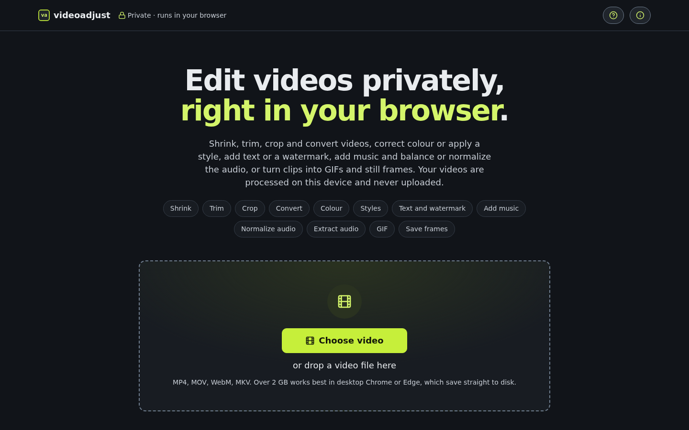

# videoadjust

[](https://github.com/bradsec/videoadjust/actions/workflows/tests.yml)
[](package.json)
[](LICENSE)
[](https://videoadjust.com/)

A private video editor that runs in your browser. Trim, crop, resize and rotate, correct colour, apply styles and overlays, add music and adjust or extract audio, make GIFs and save frames. [Mediabunny](https://mediabunny.dev/) runs conversion locally through WebCodecs, so your videos are processed on your device and never uploaded.

**Live app: https://videoadjust.com/**



## Features

- Shrink video, extract MP3, M4A or WAV audio, and make GIFs.
- Trim and cut clips; crop, rotate, resize and correct colour.
- Add styles, captions, text, images and music. Save still frames.
- Preview changes before export. The live app works offline after its first load.

## Privacy

Your videos are processed on your device and never uploaded. The static app has no analytics or remote assets. See [detailed features and privacy](docs/development.md#detailed-features).

## Browser support

The app checks browser capabilities at runtime and explains unavailable options. See [browser support and tested engines](docs/development.md#browser-support).

## Run locally

Requires Node 22 and pnpm 10.

```sh
pnpm install
pnpm dev
```

See [development and deployment](docs/development.md) for checks, build and release details.

## Support

If videoadjust is useful to you, please consider starring the repository to help others discover it.

[](https://ko-fi.com/C8G129FZKM)

## Credits and license

Credits: mediabunny (modified MPL-2.0); @mediabunny/aac-encoder and @mediabunny/ac3 (MPL-2.0, with LGPL-2.1-or-later FFmpeg WASM); @mediabunny/mp3-encoder (MPL-2.0, with LGPL-2.0-or-later LAME WASM); gifenc (MIT); Lucide Icons (ISC and MIT); @types/dom-webcodecs and @types/dom-mediacapture-transform (MIT, development only). See the [complete credits and licence audits](docs/third-party.md) and [full third-party notices](THIRD-PARTY-LICENSES.txt).

videoadjust is licensed under [MIT](LICENSE).
